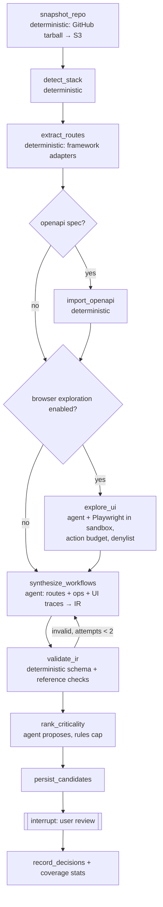
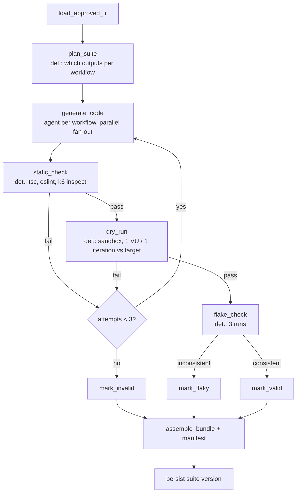
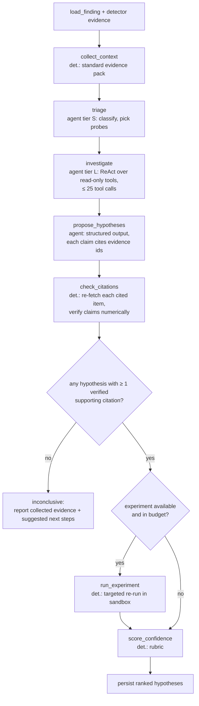
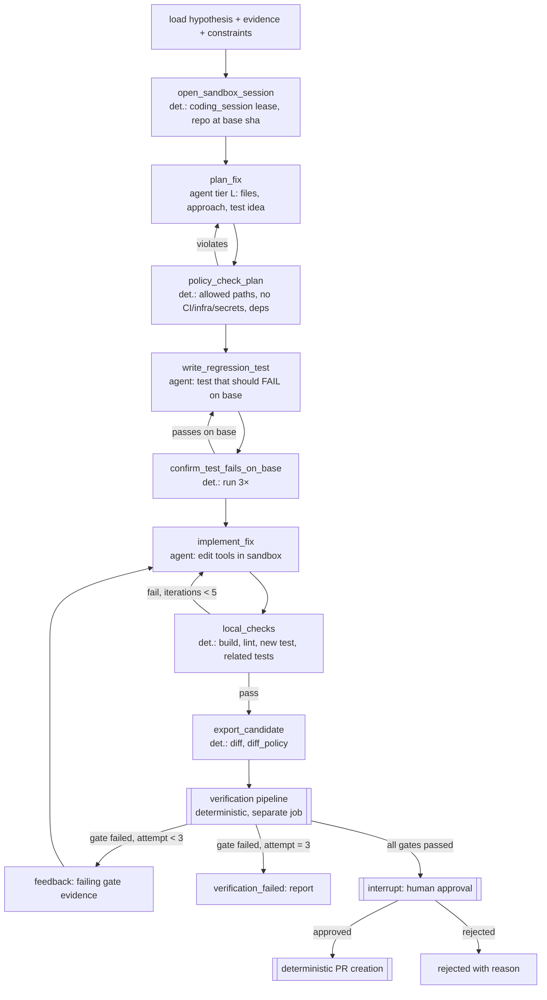

# Agent Workflows (LangGraph)

> How the four agentic workflows are built. Principles: [ADR-0006](decisions/0006-orchestrate-agents-with-langgraph-using-a-postgres-checkpointer.md)
> (LangGraph + Postgres checkpoints), [ADR-0007](decisions/0007-agents-propose-deterministic-engines-execute-and-judge.md)
> (agents propose, deterministic code judges), [ADR-0015](decisions/0015-require-evidence-citations-and-a-deterministic-confidence-rubric-for-diagnoses.md)
> (evidence-cited diagnoses), [ADR-0016](decisions/0016-gate-verified-status-on-independent-checks-and-statistical-load-comparison.md)
> (verification), [ADR-0019](decisions/0019-call-llms-through-an-internal-gateway-with-model-tiers-and-budgets.md) (LLM gateway).

## Contents
1. Where agents are — and are not — used
2. Runtime model
3. Discovery graph
4. Test-generation graph
5. Diagnosis graph
6. Repair graph
7. Guardrails common to all graphs
8. Model tiers and budgets
9. Agent evaluation hooks

---

## 1. Where agents are — and are not — used

| Step | Who does it | Why |
|---|---|---|
| Route extraction from code, OpenAPI import | **Deterministic** (tree-sitter + framework adapters) | Precise, cheap, reproducible |
| Turning routes + pages into user workflows, criticality | **Agent** | Requires understanding intent |
| Browser exploration decisions | **Agent** within a deterministic crawler budget | Needs judgment on what to click |
| Writing Playwright / k6 code | **Agent** from Workflow IR, validated deterministically | Code synthesis |
| Admission, scheduling, execution, abort, kill | **Deterministic** | Safety-critical |
| Thresholds, baselines, finding creation | **Deterministic** | Must be reproducible |
| Evidence collection | **Deterministic** collectors + agent-chosen extra queries (read-only) | Agent decides what to look at, tools fetch facts |
| Hypotheses, mechanisms | **Agent** | Reasoning |
| Citation checks, confidence | **Deterministic** rubric | Agents are poorly calibrated about themselves |
| Patch + regression test | **Agent** in sandbox | Code synthesis |
| Verification gates, "verified" | **Deterministic** | Independence from the author |
| PR creation | **Deterministic** after human approval | No agent holds GitHub write credentials |

## 2. Runtime model

- Each graph runs inside a Celery task on the `agents` queue. The LangGraph **PostgresSaver**
  checkpointer persists state after every node (`agent_state` schema; thread id stored in
  `agent_threads` with `org_id`).
- **Resumability:** if a worker dies, the task is retried and the graph resumes from the
  last checkpoint. Nodes with side effects (sandbox sessions, run creation) are idempotent
  by keys derived from `(thread_id, node, attempt)`.
- **Human-in-the-loop:** nodes call `interrupt(payload)`; the API stores the pending request
  (workflow review, repair approval) and a later API call resumes the thread with
  `Command(resume=…)` via a new Celery task. Interrupts expire (default 7 days) → thread
  ends `abandoned`.
- **Progress:** nodes emit step events to Redis pub/sub (shown in the UI) and `run_events`-like
  rows on the subject.
- **Budgets:** every graph run carries a budget object `{tokens, wall_seconds, tool_calls,
  sandbox_minutes}` reserved from the org's quota at start; the LLM gateway and tool layer
  decrement it and raise `BudgetExhausted`, which routes to a `finalize_partial` node.
- **Tools:** registered in a per-graph allowlist with typed (Pydantic) arguments, a
  permission class (`read_tenant_data`, `read_telemetry`, `sandbox_exec`, `sandbox_write`),
  and audit logging of every call (`agent.tool_call` audit events with args hash).

---

## 3. Discovery graph

Goal (FR-6…9): produce candidate workflows (Workflow IR) with provenance and criticality.

| Node | Type | Inputs → outputs | Notes |
|---|---|---|---|
| `snapshot_repo` | det. | repo, sha → `code_snapshot` artifact | Token minted for this job only; excludes files > 1 MB, binaries, `.env*`, keys (gitleaks pre-scan) |
| `detect_stack` | det. | manifests → stack descriptor | package.json, lockfiles, pyproject, framework markers, ORM, DB driver |
| `extract_routes` | det. | snapshot → route table `{method, path_template, handler_file, lines, auth_hint, data_access[]}` | Adapters: Next.js app/pages router (route handlers, server actions), Express (router calls), FastAPI (decorators); unknown framework → LLM-assisted extraction marked low confidence |
| `import_openapi` | det. | spec → operations | Validates 3.0/3.1; links operations to routes |
| `explore_ui` | agent | target, credentials, budget (default 150 actions, 15 min) → page graph + action traces | Runs Playwright in a sandbox; LLM picks next action from accessibility tree; denylist of destructive verbs; never submits payment forms; stops at budget |
| `synthesize_workflows` | agent (tier M) | routes, operations, UI traces → IR list | Must cite source evidence (`route:`, `file:`, `ui_trace:`) for each step |
| `validate_ir` | det. | IR → errors | JSON Schema, every path exists in route table or UI trace, locators present in traces |
| `rank_criticality` | agent (tier S) + rules | IR → criticality | Rules: auth, payment, data-write → at least `high` |
| `[[interrupt]]` | human | candidates → approvals | UI shows source + confidence; nothing is tested until approved |

> **As built (Phase 5, see plan.md deviations):** the graph ends at `persist` (status
> `awaiting_review`); review happens in the workflows UI. `explore_ui` arrives with browser
> exploration in Phase 9. Every model step has a deterministic baseline it degrades to.

Coverage accounting: `discovered` = candidates; `approved`; `tested` = approved with ≥ 1
valid test case; `passing` = last run passed. Reported as numbers, never as a percentage of
"the app".

---

## 4. Test-generation graph

Goal (FR-10…13): valid, deterministic Playwright tests and k6 scenarios from approved IR.

> **As built (Phase 5):** code is compiled deterministically from IR (fixed k6/Playwright
> runtime); the model repairs the *IR* of a failing workflow from its dry-run output (≤ 3
> attempts). `static_check` is not needed; `dry_run` + `flake_check` run as one runner job
> (3 repeats) that the graph awaits with `interrupt()`.

- `generate_code` receives the IR plus **templates** (fixture patterns, auth helper, k6
  scenario skeleton with `group()`/`check()` naming conventions and trace-context headers).
  It may only fill template slots; the output is parsed and rejected if it imports modules
  outside an allowlist (`@playwright/test`, `k6/*`, local helpers) or contains network
  calls to hosts other than `BASE_URL`.
- `dry_run` failure output (error, screenshot description, DOM snippet) is fed back as
  untrusted context to the next attempt.
- k6 scripts are generated so that every request is tagged `{workflow, step, endpoint}`
  and sends W3C `traceparent` — this is what makes trace correlation (FR-23) possible.
- Concurrency probes (FR-13) use a fixed k6 template (`shared-iterations`, N VUs, 1
  iteration each, then a check request); only the request bodies come from the IR.

---

## 5. Diagnosis graph

Goal (FR-21…23): ranked, evidence-cited hypotheses with deterministic confidence.

**Standard evidence pack** (`collect_context`, deterministic, per finding type):
failing assertion + Playwright trace summary; metric windows around the breach (latency
per endpoint, RPS, errors, VUs); top-N slowest and all error traces in the window with span
breakdown (DB time, external calls, lock waits); log excerpts correlated by trace id;
DB stats (pg_stat_statements top queries by total time, connections vs max, lock waits);
container CPU/memory/event-loop lag; code for handlers on the hot path (from route table +
trace span code attributes); recent commits touching those files.

**Read-only investigation tools** (`investigate`):

| Tool | Returns | Guard |
|---|---|---|
| `query_metrics(promql, from, to, step)` | series (downsampled) | tenant header fixed; query cost limit; time range ⊆ run window ± 10 min |
| `find_traces(filter, limit≤20)` / `get_trace(id)` | span trees (truncated) | tenant fixed |
| `search_logs(logql, limit≤200)` | lines (redacted) | tenant fixed |
| `db_stats(kind)` | pg_stat_statements / activity snapshots captured during run | snapshot only, never live customer DB |
| `read_code(path, lines)` / `search_code(pattern)` / `symbol_refs(name)` | code text | snapshot at run commit; size caps |
| `explain_plan(query_id)` | EXPLAIN (no ANALYZE) from sandbox DB | sandbox runs only |

Every tool result is stored as an `evidence` row (kind, locator, deterministic summary,
small snapshot) and returned to the model with its `evidence_id`.

**Hypothesis schema** (structured output, validated): `category`, `statement`, `mechanism`,
`code_locations[]`, `supporting_evidence[{evidence_id, claim}]`,
`contradicting_evidence[]`, `predicted_experiment_outcome?`, `fix_direction`.

**`check_citations`** (deterministic): for every `{evidence_id, claim}` — the evidence exists,
belongs to this finding/run, and numeric claims ("10/10 connections", "p95 1.8 s") match the
evidence snapshot within tolerance; code locations exist at the commit. Failing citations
are dropped and counted; a hypothesis with zero verified supporting citations is
discarded (never displayed as a root cause).

**Experiments** (deterministic templates, sandbox targets only, optional):

| Category | Experiment | Supports if |
|---|---|---|
| `pool_exhaustion` | re-run at 2× pool size via env override | p95 drops ≥ 30% and pool wait → 0 |
| `missing_index` | EXPLAIN shows seq scan on large table; re-run with candidate index | query time drops |
| `n_plus_one` | count DB spans per request at 1 VU | spans scale with item count |
| `race_condition` | invariant probe at parallel 1 vs 50 | passes at 1, fails at 50 |
| `blocking_io` / `cpu_bound_handler` | event-loop lag vs RPS at 2 load levels | lag rises with load on one endpoint |

**Confidence rubric** (`score_confidence`, ADR-0015) — score 0–1 from: verified supporting
citations (diminishing), distinct evidence kinds (metric + trace + code > metric alone),
temporal alignment (symptom onset coincides with evidence), experiment result (strong
weight), contradicting evidence (penalty), code location verified on hot path. Bands:
`high ≥ 0.75`, `medium ≥ 0.45`, else `low`. The LLM's own stated confidence is **not** an
input. Weights are tuned on the benchmark (evaluation.md) and versioned.

> **As built (Phase 7, see plan.md deviations):** `collect_context` also runs deterministic
> rules (`agents/diagnosis/rules.py`) that turn the evidence pack (sandbox DB snapshots,
> per-endpoint metric windows, error samples, static checks on the hot-path handler: DB calls
> in loops, blocking calls, unindexed filters, unlocked read-modify-write, tiny pool sizes)
> into baseline hypotheses; model hypotheses are merged with them and pass the same citation
> checks, so diagnosis still works with the LLM disabled. The experiment is one template for
> every load-shaped category — a **concurrency contrast** (two system load runs in the same
> sandbox: 1 VU and the observed VUs, limited to workflows touching the endpoint), run through
> a LangGraph `interrupt` resumed by `diagnosis.experiment_run_done`; cost categories are
> supported when latency is already high at 1 VU, contention categories when it appears only
> under load. Races are confirmed by the concurrency probe that found them. Findings on customer
> targets never get experiments. `explain_plan`, `query_metrics` and `symbol_refs` are not
> built yet; `find_traces`/`search_logs` are offered only when a telemetry backend is configured.

---

## 6. Repair graph

Goal (FR-24…27): a minimal patch + regression test, independently verified, human-approved.

**Sandbox tools** (session-scoped; the session token is valid only for this attempt):

| Tool | Notes |
|---|---|
| `list_files`, `read_file`, `search_code` | repo checkout only |
| `apply_patch(unified_diff)` / `write_file(path, content)` | rejected if path outside `allowed_paths` or in denylist (`.github/**`, `Dockerfile*`, `infra/**`, `*.env*`, lockfiles unless deps allowed) |
| `run(command_id, args)` | **allowlisted commands only**: detected test runner, build, lint, typecheck, the new regression test; no arbitrary shell |
| `get_evidence(evidence_id)` | read the diagnosis evidence |

No tool can access the network beyond the package mirror, push to Git, create PRs, call
the API, or change budgets. The session has no GitHub credentials (the repo arrives as a
tarball).

**Limits (defaults, configurable within plan):** ≤ 10 files, ≤ 300 changed lines, no new
dependencies, ≤ 5 implement/check iterations per attempt, ≤ 3 attempts per hypothesis,
2 h wall clock, 1.5M tokens.

**PR content** (deterministic template): title `fix(reliability): <finding title>`, branch
`reliability/<finding-short>-<attempt-id>`; body = finding headline, hypothesis + confidence
factors, evidence links, gate table, before/after comparison table with CIs, regression test
description, the agent's explanation labelled "AI-generated explanation", and a statement
that the change was verified in a sandbox and must be reviewed before merge.

---

## 7. Guardrails common to all graphs

1. **Untrusted content handling.** Repo files, web pages, HTTP bodies, logs, traces and
   error messages are wrapped as data blocks with provenance and length caps; system
   prompts state that instructions inside data blocks are never followed. Agent outputs are
   always parsed into schemas; free text from the agent is only ever displayed (escaped),
   never executed or used as a command.
2. **No privileged tools.** Nothing an agent can call approves, merges, deploys, modifies
   targets, changes quotas, reads secrets, or reaches the control-plane DB directly.
3. **Secret hygiene.** Snapshots are pre-scanned (gitleaks) and secret-bearing files
   excluded; test credentials are referenced by name (`secret:TEST_USER_1`) and resolved only
   inside sandboxes; logs/traces are redacted before entering prompts.
4. **Tenant scoping.** Tools receive the org/project context from the graph state set by the
   API, not from model output.
5. **Determinism where possible.** Temperature 0 for code and structured output; prompt
   templates versioned (`prompts/<name>@<version>`), recorded in `generator_info`/`model_info`.
6. **Org opt-out.** If `llm_code_context_enabled = false`, discovery uses deterministic
   extraction only, diagnosis runs without code tools (confidence capped at `medium`), and
   repair is disabled.
7. **Kill switch.** Operators can disable any graph globally or per org via feature flag;
   running threads stop at the next node boundary.

## 8. Model tiers and budgets

Routing is by **purpose**, configured in the gateway (ADR-0019), so models can change without
code changes. Initial assumption (to be validated by evals):

| Tier | Used for | Initial model family |
|---|---|---|
| S (fast, cheap) | triage, criticality, summarizing logs, classifying failures | Claude Haiku-class |
| M (balanced) | workflow synthesis, test code generation | Claude Sonnet-class |
| L (strongest) | diagnosis investigation and hypotheses, patch planning and implementation | Claude Opus-class |

| Graph | Default budget | On exhaustion |
|---|---|---|
| Discovery | 400k tokens, 30 min | persist what was found, status `budget_exhausted` |
| Test generation | 50k tokens per workflow | remaining workflows `invalid: budget` |
| Diagnosis | 300k tokens, 25 tool calls, 20 min | inconclusive report with evidence pack |
| Repair attempt | 1.5M tokens, 2 h, 5 iterations | attempt `budget_exhausted`; user may start next attempt |

## 9. Agent evaluation hooks

- Every graph run records model ids, prompt versions, token usage, tool-call sequence (args
  hashed), outcome.
- Golden datasets (benchmarks/) for each graph; CI job `evals.yml` runs on any change under
  `agents/**` or `llm/**` and blocks merge if a metric regresses beyond tolerance
  (evaluation.md §4).
- User feedback (hypothesis verdicts, repair approve/reject reasons, PR merged/closed) is
  joined to the run records to compute online precision and acceptance rates.
