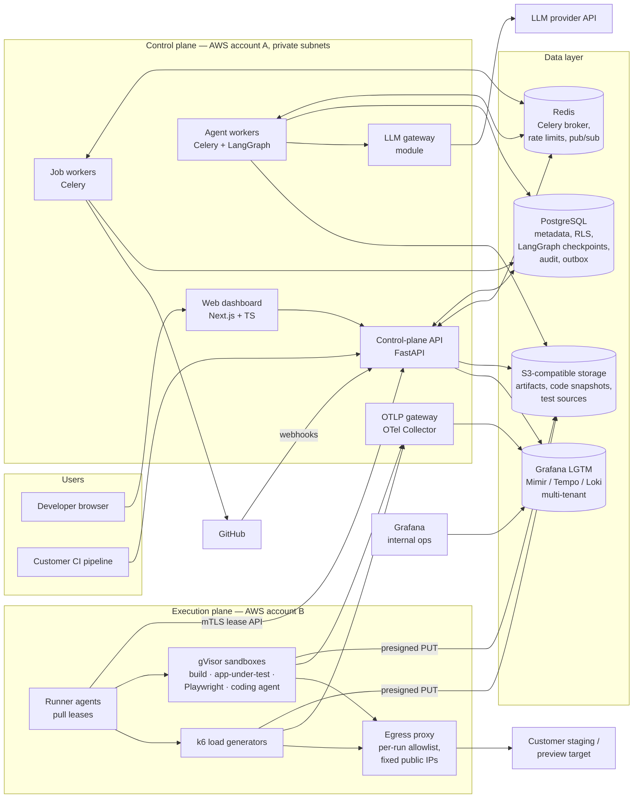

# Agentic AI Software Reliability Engineer — System Design

> Living document. Updated at the end of every gate and whenever an ADR changes.
> Working name used throughout: **Reliability Engineer** (the product), **RE** (the platform).

## Architecture Status

**Current gate:** 7 — Implementation plan written, **awaiting approval**
**Approved for implementation:** no
**Mode:** fast path. The brief answered most Gate 1–2 questions, so Gates 1–6 ran in one
pass. Every choice the brief did not make is marked **Recommended** or **Assumed** below and
needs your confirmation at Gate 7.

| Confidence | Decisions |
|---|---|
| Confirmed (stated in the brief) | Next.js + TypeScript dashboard · FastAPI control plane · PostgreSQL ([ADR-0002](decisions/0002-use-postgresql-as-the-system-of-record.md)) · Redis + Celery ([ADR-0004](decisions/0004-use-celery-on-redis-for-control-plane-jobs-with-a-transactional-outbox.md)) · S3-compatible artifact storage ([ADR-0005](decisions/0005-store-artifacts-in-s3-compatible-object-storage-with-tenant-prefixed-keys.md)) · LangGraph ([ADR-0006](decisions/0006-orchestrate-agents-with-langgraph-using-a-postgres-checkpointer.md)) · Playwright + k6 ([ADR-0012](decisions/0012-use-playwright-for-functional-tests-and-protocol-level-k6-for-load.md)) · OpenTelemetry + Prometheus + Grafana as the observability stack · Docker workers, Kubernetes only when justified · human approval before PRs, no automatic deployment · MVP scope and SLO targets from the brief |
| Recommended (ADR `proposed`) | Modular monolith + monorepo (0001) · Shared-schema tenancy with Postgres RLS (0003) · Agents propose, deterministic engines execute and judge (0007) · Separate execution plane with pull-based runners (0008) · gVisor sandboxing (0009) · Target ownership verification + egress allowlist + no production load tests in MVP (0010) · Workflow IR as the source of generated tests (0013) · Grafana LGTM (Mimir/Tempo/Loki) for evidence telemetry (0014) · GitHub App, PR-only (0017) · Evidence-cited hypotheses with a deterministic confidence rubric (0015) · Verification gates with statistical performance comparison (0016) · SSE for live progress (0021) · In-app charts, Grafana internal only (0022) · Hash-chained audit log (0023) · Admission control with plan quotas and safety caps (0024) |
| Assumed (ADR `proposed`, tag `assumed`) | Managed OIDC identity provider with GitHub login (0018) · LLM gateway with Anthropic Claude model tiers (0019) · AWS as the cloud (0020) · Sandbox builds for verification with preview-URL fallback (0011) · Year-1 scale numbers (NFR-10) · Initial framework support: Next.js, Express, FastAPI (FR-6) · Team of 3–6 engineers |
| Deferred | Kubernetes + k6-operator — distributed load > 1 generator, > ~20 execution hosts, or multi-region generators · Production load testing — first enterprise customer with change-window process · Multi-region control plane — SLA above 99.9% or data-residency contract · Billing integration (Stripe) — first paid plan launch (quotas exist from day 1) · Self-hosted / BYO-cloud runners — customer cannot expose staging or demands data stay in their VPC · Browser-based load (k6 browser) — customer need for front-end rendering performance under load · Supabase/Firebase emulation in sandboxes — > 30% of onboarding attempts blocked by BaaS dependencies · PDF reports — customer request; HTML + JSON first · SSO/SAML — first team-plan customer requiring it |

### Document map

| Document | Contents |
|---|---|
| [design.md](design.md) (this file) | Product, requirements, high-level architecture, summaries of every area, risks |
| [low-level-design.md](low-level-design.md) | Module boundaries, cross-cutting rules, background jobs, Workflow IR, frontend screens, testing strategy |
| [data-model.md](data-model.md) | PostgreSQL schema (DDL), RLS, indexes from query patterns, retention |
| [api-contract.md](api-contract.md) | REST API v1, runner lease API, OTLP ingest, webhooks, error model, rate limits |
| [agent-workflows.md](agent-workflows.md) | LangGraph graphs: discovery, test generation, diagnosis, repair; tools, budgets, guardrails |
| [threat-model.md](threat-model.md) | Assets, trust boundaries, STRIDE, abuse cases, controls, residual risk |
| [operations.md](operations.md) | Deployment architecture, failure modes, capacity math, observability, SLOs, DR, cost |
| [evaluation.md](evaluation.md) | Benchmarks, reference environment, how each success criterion is measured |
| [plan.md](plan.md) | Phased roadmap and implementation plan with file-level traceability |
| [README.md](README.md) | ADR index |

---

## 1. Product definition

**Reliability Engineer** is a multi-tenant SaaS that acts as an automated reliability
engineer for small teams shipping AI-generated ("vibe-coded") web applications. A developer
connects a GitHub repository and a staging URL they control. The platform discovers the
application's routes and workflows, generates executable Playwright functional tests and k6
load scenarios, runs them in isolated infrastructure at up to 1,000 concurrent virtual users,
and turns failures and bottlenecks into **findings**. For each finding it gathers telemetry,
traces, logs and code context, proposes **evidence-cited root-cause hypotheses**, and on
request asks a coding agent for a patch plus a regression test. A deterministic verification
pipeline — not the agent — re-runs functional, security and load tests against the patched
build and compares it to the baseline. Only a patch that passes every gate can be turned into
a GitHub pull request, and only after a human approves it. The platform never merges, never
deploys, and never claims complete coverage or guaranteed fixes; it reports what it discovered,
what it tested, and how confident it is.

**Stage:** production-grade MVP — a real multi-tenant service with real customers, built at
the smallest scale tier that meets the SLOs, with a validated path to grow.

### Users and roles

| Persona | Needs | Role |
|---|---|---|
| Indie hacker / solo founder | "Will my app survive launch day?" in under an hour, minimal setup | owner |
| Startup engineer | Regression + load checks before deploys, fixes as PRs | admin / engineer |
| Team lead | Trends, coverage, approval control, audit | admin |
| Stakeholder | Read-only reports | viewer |

### User flows

**UF-1 Onboarding.** Sign up with GitHub → organization created → create project → install
GitHub App on chosen repo → register staging URL → add DNS TXT record or upload
`/.well-known/reliability-engineer.txt` → **Verify** → target verified, egress allowlisted.

**UF-2 Discovery.** Choose commit (default branch HEAD) → optionally upload OpenAPI spec and
enable browser exploration (needs test credentials) → discovery job runs (static analysis →
OpenAPI import → bounded crawl → workflow synthesis) → candidate workflows listed with
source, confidence and criticality.

**UF-3 Test configuration.** Approve/edit/reject candidates, add manual workflows → set test
data and credentials → generate suite (Playwright + k6 from Workflow IR, each validated by a
dry run) → create load profiles: type, VUs, duration, ramp, think time, workload mix,
thresholds (default p95 < 500 ms, errors < 1%).

**UF-4 Execution.** Run smoke → baseline (low load) → controlled load test. Admission control
checks verification, environment policy, quotas and approvals. Live dashboard: VUs, RPS,
p50/p95/p99, error rate, failed checks, generator health; **Stop** halts traffic within 10 s.

**UF-5 Investigation.** Findings list (functional failures, SLO breaches, regressions,
saturation, race-condition probes) → finding detail: failed assertions with Playwright trace,
latency/error charts, slow traces, log excerpts, DB statistics, code locations → **Diagnose**
→ ranked hypotheses, each with cited evidence and a rubric-based confidence; users mark them
confirmed/refuted.

**UF-6 Repair and verification.** **Propose fix** on a hypothesis → coding agent produces
patch + regression test in a sandbox → verification gates run (build, existing tests,
fail-to-pass regression, functional suite, security scans, baseline-vs-patched load
comparison) → side-by-side results → engineer approves → PR opened with diff, tests,
evidence and before/after metrics.

**UF-7 Reporting.** Run history, per-workflow/endpoint trends, coverage (discovered →
approved → tested → passing), open findings, repair outcomes, comparisons; shareable HTML
report and JSON export.

---

## 2. Requirements

### Functional (EARS)

**Tenancy, onboarding and targets**
- **FR-1** When a user signs up, the system shall create an organization with that user as owner.
- **FR-2** When an owner or admin connects GitHub, the system shall install the GitHub App on the repositories they select and link exactly one repository to a project.
- **FR-3** When a user registers a target URL, the system shall send no test traffic to its host, other than the verification request, until the user proves control of the host by DNS TXT record or an HTTP well-known token.
- **FR-4** If a target's verification expires, fails re-verification, or is revoked, then the system shall reject new runs against it and abort in-flight runs within 10 s.
- **FR-5** The system shall classify each target as `sandbox`, `preview`, `staging` or `production`; where a target is `production`, the system shall refuse load, stress, spike and soak profiles and allow only rate-limited smoke runs after explicit owner approval.

**Discovery**
- **FR-6** When discovery is requested, the system shall analyze the repository at a pinned commit to extract framework, routes, handlers, data-access calls and dependencies (initially Next.js, Express and FastAPI applications).
- **FR-7** Where an OpenAPI 3.x specification is supplied by upload, URL or repository path, the system shall import its operations as API workflow candidates.
- **FR-8** Where browser exploration is enabled, the system shall crawl the verified target within a bounded action budget and shall not perform denylisted destructive actions (delete, payment, account closure, email send) unless the user has approved them for that workflow.
- **FR-9** When discovery completes, the system shall list candidate workflows with source, confidence and criticality, and report counts of discovered, approved, tested and passing workflows.

**Test generation and configuration**
- **FR-10** When workflows are approved, the system shall generate Playwright tests and k6 scenarios from a schema-validated Workflow IR and validate each by static checks and a dry run before marking it usable.
- **FR-11** The system shall let users configure test data and credentials (stored encrypted, never displayed again), workload mix, VUs, duration, ramp-up, think time and acceptance thresholds per load profile.
- **FR-12** If a generated test still fails validation after 3 automated repair attempts, then the system shall mark it `invalid` with the reason and exclude it from runs.
- **FR-13** Where a workflow declares a business invariant (for example "a coupon is redeemed at most once"), the system shall generate a concurrency probe that issues N parallel requests and checks the invariant.

**Execution**
- **FR-14** When a run is requested, the system shall apply admission control — target verified, environment policy, plan quotas, concurrency caps, required approvals — before queueing it.
- **FR-15** While a run executes, the system shall stream VUs, request rate, latency percentiles, error rate, check failures and load-generator health to the dashboard with at most 5 s delay.
- **FR-16** The system shall support smoke, baseline, load, stress, spike and soak profiles within plan limits (MVP ceiling: 1,000 VUs, soak up to 60 min).
- **FR-17** If a run breaches its abort conditions (error rate above the abort threshold for 30 s, target unreachable, generator saturated), then the system shall stop the run and record the reason.
- **FR-18** When a user presses Stop, or an operator triggers the global kill switch, the system shall halt all traffic for the affected runs within 10 s.
- **FR-19** If the load generator exceeds 85% CPU or drops iterations, then the system shall mark the run's performance results `invalid` instead of attributing latency to the target.

**Detection and diagnosis**
- **FR-20** When a run completes, the system shall evaluate thresholds and baselines and create or update findings, deduplicated by fingerprint (functional failure, SLO breach, regression vs baseline, resource saturation, error spike, invariant violation, flaky test).
- **FR-21** When a finding is diagnosed, the system shall collect evidence (assertions, metric windows, traces, logs, database statistics, code locations) and produce ranked hypotheses, each citing at least one supporting evidence item; the system shall not present an uncited hypothesis as a root cause.
- **FR-22** The system shall show each hypothesis's confidence as computed by the documented rubric and let users mark it confirmed or refuted.
- **FR-23** Where server-side telemetry is available (sandbox auto-instrumentation, or customer OTLP export with a project ingest token), the system shall correlate it with run requests via W3C trace context.

**Repair and verification**
- **FR-24** When a user requests a fix for a hypothesis, the system shall generate a patch and a regression test in a sandbox against the pinned base commit, within configurable limits on diff size and editable paths.
- **FR-25** When a candidate patch exists, the system shall run verification gates independently of the agent: build, existing tests, regression fail-to-pass, functional suite, security scans and, for performance findings, a repeated baseline-vs-patched load comparison.
- **FR-26** The system shall mark a patch `verified` only when every applicable gate passes, and shall show which gate failed with its evidence otherwise.
- **FR-27** When an engineer, admin or owner approves a verified patch, the system shall push a branch and open a pull request containing the diff, tests, evidence summary and before/after metrics; the system shall never merge, deploy, or push to the default branch.

**Reporting and governance**
- **FR-28** The system shall provide run history, per-workflow and per-endpoint trends, coverage, open findings, repair outcomes and baseline-vs-patched comparisons, exportable as shareable HTML and JSON.
- **FR-29** The system shall write an append-only audit event for every security-relevant action: sign-in, membership and key changes, target verification, run start/stop, approvals, secret writes, agent tool calls, PR creation.
- **FR-30** The system shall enforce roles owner, admin, engineer and viewer on every endpoint.
- **FR-31** The system shall enforce per-organization quotas (VU-minutes, sandbox-minutes, LLM tokens, concurrent runs) and per-key rate limits.
- **FR-32** Where a CI pipeline calls the API with a scoped API key, the system shall run a configured suite against a verified target and return a pass/fail verdict suitable for gating a deploy.

### Non-functional

| NFR | Target | Confidence |
|---|---|---|
| NFR-1 Load capacity | Sustain 1,000 VUs for 10 min from one generator in the reference environment with generator CPU < 80% and zero dropped iterations | Confirmed (brief) — validate by benchmark |
| NFR-2 Target workload SLO | Defaults: p95 < 500 ms, failed requests < 1% (expected failures excluded); configurable per profile | Confirmed (brief) |
| NFR-3 Control-plane availability | 99.9% monthly (≈ 43 min error budget) for API, dashboard and job admission | Confirmed (brief) |
| NFR-4 Job start | 95% of queued jobs start within 30 s at the reference platform load (NFR-10) | Confirmed (brief) |
| NFR-5 Dashboard latency | API p95 < 300 ms for reads; live metrics ≤ 5 s behind | Assumed |
| NFR-6 Tenant isolation | Zero cross-tenant reads/writes, enforced in DB (RLS), storage (prefix + presign), telemetry (tenant header), execution (per-run network) | Recommended |
| NFR-7 Safety | Zero traffic to unverified hosts; zero production load tests; zero automatic merges or deploys; kill switch ≤ 10 s | Confirmed (brief) |
| NFR-8 Retention | Raw artifacts (traces, videos, raw k6 output, telemetry) 30 days; summaries, findings, repairs 13 months; audit 1 year; code snapshots deleted ≤ 24 h after the job | Assumed |
| NFR-9 RPO / RTO | Control plane RPO ≤ 5 min, RTO ≤ 1 h; in-flight runs may be lost and are re-queued | Assumed |
| NFR-10 Platform scale (year 1) | ~300 active orgs, ~1,000 projects; peak 25 concurrent load runs + 100 functional runs/hour + 10 concurrent repair sessions | Assumed |
| NFR-11 Unit cost | ≤ ~2.5 vCPU-hours compute per 10-min 1,000-VU run; LLM budget ≤ 300k tokens per diagnosis, ≤ 1.5M tokens per repair attempt (tunable) | Assumed |
| NFR-12 Diagnosis quality | 100% of shown root causes carry evidence; top-3 precision measured on the benchmark (initial goal ≥ 60%) and on user feedback | Recommended |
| NFR-13 Repair safety | False-verified rate (verified patch later judged wrong by reviewer) tracked; goal < 5%, alert on any trend up | Recommended |
| NFR-14 Compliance | SOC 2-ready controls (audit, access review, change management) without certification at MVP; GDPR basics (DPA, erasure, sub-processor list incl. LLM provider) | Assumed |
| NFR-15 Accessibility | Dashboard meets WCAG 2.1 AA | Assumed |

These are **initial targets to validate with repeatable benchmarks** ([evaluation.md](evaluation.md)), not guarantees.

### Business constraints

- Small team (Assumed 3–6 engineers): prefer managed services; one Python codebase for the control plane; no microservices.
- Price-sensitive customers: execution capacity must scale toward zero when idle; LLM spend must be budgeted per org and per job.
- Trust is the product: every claim shown to a user (finding, hypothesis, "verified") must be backed by stored evidence.
- Legal exposure from load traffic: the platform must not be usable as a DDoS tool.

### Out of scope (MVP)

- Guaranteed discovery or testing of every feature; guaranteed root cause; guaranteed repair.
- Autonomous production fixes, merges or deployments.
- Testing unverified, third-party or unauthorized targets; production load testing.
- Mobile apps, desktop apps, complex distributed systems, non-HTTP protocols (gRPC, raw TCP; WebSockets limited to smoke checks).
- Multi-region load generation, > 1,000 VUs per run.
- Running customer production databases or real third-party services inside sandboxes (stubs only).
- Billing system integration (quotas only), SSO/SAML, on-prem deployment.

---

## 3. High-level architecture

**Key boundaries**
1. **Control plane vs execution plane** ([ADR-0008](decisions/0008-run-all-untrusted-execution-in-a-separate-execution-plane-with-pull-based-runners.md)): untrusted code (customer builds, generated tests, agent edits) and outbound test traffic exist only in the execution plane, in a separate cloud account with no database or Redis credentials. Runners pull work over mTLS and upload results through presigned URLs.
2. **Agents vs judges** ([ADR-0007](decisions/0007-agents-propose-deterministic-engines-execute-and-judge.md)): LLM agents discover, plan, hypothesize and write patches. Deterministic code admits runs, executes tests, evaluates thresholds, computes confidence and decides "verified". No agent has a tool that approves, merges, or widens its own permissions.
3. **Tenant boundary** ([ADR-0003](decisions/0003-isolate-tenants-with-a-shared-schema-and-postgres-row-level-security.md)): every row, object key, telemetry series and sandbox network is scoped to one organization.

| Component | Responsibility | Exists because | ADR |
|---|---|---|---|
| Web dashboard | Onboarding, configuration, live runs, findings, hypotheses, repair review, reports | UF-1…7, FR-9, FR-15, FR-28 | 0022 |
| Control-plane API | AuthN/Z, projects, targets, admission control, runner lease API, SSE, reporting | FR-1…5, FR-14, FR-30…32 | 0001 |
| Job workers (Celery) | Target verification, report generation, threshold evaluation, GitHub calls, retention cleanup, scheduling | FR-3, FR-20, FR-27, NFR-8 | 0004 |
| Agent workers (LangGraph) | Discovery, test generation, diagnosis, repair graphs with checkpoints and human interrupts | FR-6…13, FR-21, FR-24 | 0006, 0007 |
| LLM gateway | Model routing, budgets, redaction, structured-output validation, usage metering | FR-31, NFR-11, threat model | 0019 |
| OTLP gateway | Authenticates and tenant-tags telemetry from sandboxes, generators and customer apps | FR-15, FR-23, NFR-6 | 0014 |
| PostgreSQL | System of record, RLS, LangGraph checkpoints, outbox, audit log | all | 0002, 0003, 0023 |
| Redis | Celery broker, rate-limit buckets, live-metric pub/sub | NFR-4, FR-15, FR-31 | 0004, 0021 |
| Object storage | Code snapshots, test sources, k6 raw output, Playwright traces, patches, reports | FR-10, FR-25, FR-28 | 0005 |
| LGTM stack | Queryable metrics, traces and logs per tenant for diagnosis and charts | FR-21, FR-23 | 0014 |
| Runner agents | Lease jobs, start sandboxes/generators, enforce local limits, heartbeat, kill | FR-16…19, NFR-4 | 0008 |
| gVisor sandboxes | Isolated build, app-under-test, Playwright, coding agent tools | FR-10, FR-24, FR-25 | 0009, 0011 |
| k6 generators | Protocol-level load up to 1,000 VUs per run | FR-16, NFR-1 | 0012 |
| Egress proxy | Only verified hosts reachable; fixed IPs customers can allowlist | FR-3, NFR-7 | 0010 |
| GitHub App | Repo read, branch push, PR creation; webhooks | FR-2, FR-27 | 0017 |
| Identity provider | Sign-in (GitHub, email), MFA | FR-1, FR-30 | 0018 |

---

## 4. Low-level design (summary)

Full detail: [low-level-design.md](low-level-design.md), [data-model.md](data-model.md),
[api-contract.md](api-contract.md), [agent-workflows.md](agent-workflows.md).

### Modules (modular monolith, one Python package `reliability`)

`identity` · `tenancy` · `projects` · `integrations.github` · `targets` · `secrets` ·
`discovery` · `workflows` · `testsuites` · `loadprofiles` · `admission` · `runs` ·
`runners` (lease API) · `telemetry` · `findings` · `diagnosis` · `repairs` · `verification` ·
`approvals` · `reports` · `audit` · `quotas` · `llm` (gateway) · `notifications`.
Modules communicate through service interfaces only; only a module's repository touches its tables.

### Data model (core entities)

`organizations`, `users`, `memberships`, `api_keys`, `plans`, `usage_ledger` ·
`projects`, `github_installations`, `repositories`, `targets`, `project_secrets`,
`openapi_specs` · `discovery_runs`, `workflows` (Workflow IR as JSONB), `test_suites`,
`test_cases`, `load_profiles` · `runs`, `run_events`, `run_metric_summaries`, `artifacts` ·
`findings`, `evidence`, `diagnoses`, `hypotheses`, `hypothesis_evidence` ·
`repair_attempts`, `verification_gates`, `performance_comparisons`, `pull_requests` ·
`approvals`, `audit_events`, `outbox`, `llm_usage`, `runner_leases`.
Every tenant-owned table carries `org_id` with an RLS policy.

### API

REST + OpenAPI at `/v1`, cookie-less bearer auth (IdP JWT or API key), cursor pagination,
`Idempotency-Key` on creating POSTs, one error envelope, SSE at `/v1/runs/{id}/events`.
Separate internal **runner lease API** (mTLS) and **OTLP ingest** endpoints.

### Agent workflows

Four LangGraph graphs — **Discovery**, **Test generation**, **Diagnosis**, **Repair** — with
Postgres checkpoints, `interrupt()` for human review, per-node token and time budgets, and
read-only tools except the repair graph's sandbox-scoped file edits. Run execution and
verification are deterministic pipelines, not graphs.

### Client screens

`/login` · `/onboarding` · `/projects` · `/projects/[id]` (overview) · `.../targets` ·
`.../discovery` · `.../workflows` · `.../suites` · `.../profiles` · `.../runs` ·
`.../runs/[runId]` (live + results) · `.../findings` · `.../findings/[fid]` (evidence +
hypotheses) · `.../repairs/[rid]` (diff, gates, comparison, approve) · `.../reports` ·
`/settings/{members,api-keys,usage,audit,integrations}`.

### Testing strategy

Unit (rules: admission, rubric, comparison statistics) · integration (repositories against
real Postgres with RLS on; adapters against MinIO, fake GitHub, fake LLM) · API contract
(every endpoint incl. cross-tenant denial) · agent evals (golden datasets, run in CI on prompt
changes) · end-to-end (UF-1→UF-6 against the seeded-defect reference app) · platform load
tests (NFR-1, NFR-4).

---

## 5. Security model (summary)

Full model: [threat-model.md](threat-model.md).

| Attacker question | Mitigation |
|---|---|
| Can someone use us to DDoS a site they don't own? | Ownership verification (DNS TXT / well-known token, re-checked before each run and every 24 h) · egress proxy allows only the run's verified hosts · VU/duration caps per plan · global and per-org kill switch · abuse monitoring on traffic anomalies · fixed published egress IPs · ADR-0010, ADR-0024 |
| Can a run hit production by accident? | Environment classification · production blocks all non-smoke profiles (MVP) · smoke on production needs owner approval and is rate-limited · ADR-0010 |
| Can customer code or an LLM-written patch escape the sandbox? | gVisor runtime, no privileged containers, no host mounts, no cloud metadata, per-run network namespace, CPU/memory/pid/disk/time limits, separate cloud account, no control-plane credentials · ADR-0008, ADR-0009 |
| Can prompt injection in a repo or web page make an agent do harm? | Agents have no approve/merge/push tools · tools are read-only or sandbox-scoped · outputs schema-validated · PR creation is deterministic after human approval · untrusted content is delimited and never used as instructions · ADR-0007 |
| Can tenant A read tenant B's runs, code or telemetry? | Postgres RLS on every tenant table · tenant-prefixed object keys accessed only via short-lived presigned URLs · LGTM tenant header set by gateway from the authenticated token · tests prove cross-tenant denial · ADR-0003 |
| What is most valuable to steal? | GitHub installation tokens (minted per job, 1 h, never enter sandboxes); test credentials (KMS envelope-encrypted, injected only into the run, redacted from artifacts); customer source (snapshots encrypted, deleted ≤ 24 h) |
| Cheapest way to run up our bill? | Admission control with quotas on VU-minutes, sandbox-minutes, LLM tokens, concurrent runs; per-node LLM budgets; per-key rate limits · ADR-0024 |
| What if an admin account or vendor key leaks? | MFA for owners/admins · API keys hashed, scoped, expiring · audit log hash chain · GitHub App permissions limited to contents/PRs on selected repos · secrets in a secret manager with rotation |

---

## 6. Reliability, scale and operations (summary)

Full detail: [operations.md](operations.md).

### Failure modes (top)

| Failure | Detection | User-visible behavior | System behavior | Recovery |
|---|---|---|---|---|
| Postgres primary fails | RDS event, readiness probe | ≤ 2 min of 503s with retry hint | Multi-AZ failover; API fails fast | Automatic; PITR for corruption |
| Redis unavailable | Health check, Celery errors | Live charts pause; new jobs wait | Outbox accumulates in Postgres; rate limiter fails closed for run creation, open for reads | Outbox relay drains on recovery |
| Runner/host dies mid-run | Lease heartbeat missed (15 s) | Run shows `errored: runner lost` | Lease expires; egress for that run revoked; run not auto-retried if load already sent | User re-runs; quota refunded |
| Load generator saturated | Generator CPU / dropped iterations | Results flagged `invalid` | Run aborted or results quarantined | Re-run on larger generator class |
| Target down / 5xx flood | Error-rate abort condition | Run stopped, finding created | k6 `abortOnFail` + runner kill | — |
| LLM provider outage / rate limit | Gateway error rate | Diagnosis/repair "delayed" | Retries with backoff, fallback model tier, graph checkpoint resumes | Auto-resume when healthy |
| Agent loop runs away | Token/time budget exceeded | Job ends `budget_exhausted` with partial results | Node-level budgets enforced by gateway | User can extend once |
| GitHub API failure on PR creation | HTTP error | "PR pending" | Idempotent retry via outbox | Manual retry button |
| Bad deploy | Error-rate SLO burn | — | Health-checked rolling deploy | One-command rollback; expand/contract migrations |

### Scale tier

**Tier 2 for the control plane, elastic pool for the execution plane.** Control plane: two+
stateless API tasks across AZs, Celery worker pools per queue, Multi-AZ RDS, Multi-AZ Redis
(99.9% needs no single-AZ dependency). Execution plane: autoscaled host pool sized by queue
depth with a warm pool for NFR-4. Back-of-envelope (detail in operations.md): peak 25
concurrent 1,000-VU runs × ~10 vCPU (4 generator + 6 app/DB sandbox) ≈ 250 vCPU ≈ 16
hosts of 16 vCPU at peak, 2–3 warm hosts at idle. A 1,000-VU run with 1–3 s think time
generates ~300–700 req/s — well within one 4-vCPU k6 generator. Kubernetes is Deferred.

### Observability

Platform: OTel SDK in API/workers/runners → OTel Collector → Grafana Cloud or internal LGTM
tenant `platform`; RED metrics per endpoint and queue, job queue age, lease heartbeat
lag, LLM latency/tokens/cost, sandbox start time. SLO burn-rate alerts for NFR-3 and NFR-4.

### Deployment

Terraform; GitHub Actions CI (lint, typecheck, tests, agent evals, image build + scan, SBOM);
images built once, promoted staging → production; ECS rolling deploys; Alembic migrations
as a pre-deploy task (expand/contract). Execution-plane AMIs baked with Packer
(Docker + gVisor + pre-pulled runner images).

### Backups and DR

RDS automated backups + PITR (7–35 days), weekly restore drill to staging; S3 versioning on
the artifacts bucket with lifecycle expiry; LGTM data is reconstructible evidence (30-day
retention, no backup); Terraform recreates infrastructure; documented runbook.

### Cost drivers

1. Execution compute (load + sandbox minutes) — lever: warm pool sizing, spot instances for
   non-load sandboxes, per-plan caps.
2. LLM tokens (diagnosis, repair) — lever: model tiering, evidence pre-summarization,
   prompt caching, budgets, deterministic triage before LLM.
3. Telemetry storage — lever: tail sampling (keep errors and slow traces), 30-day retention,
   S3 backends.
4. Managed data services (RDS Multi-AZ, Redis) — lever: right-size; reserved instances once stable.
5. Egress/NAT — lever: load traffic targets are external by nature; keep artifacts in-region.

---

## 7. Development tooling

| Tool | Type | Serves (phase / ADR) | Scope | Access | Status |
|---|---|---|---|---|---|
| GitHub MCP (already connected in this environment) | MCP | Phase 0 issue tracking; Phase 7 GitHub App testing | session | repo-scoped | installed |
| Playwright MCP | MCP | Phases 3, 9: drive the reference app and dashboard while building tests | project | local browser only | proposed (Gate 7) |
| `claude-api` skill | skill | Phase 2 LLM gateway (model IDs, caching, structured outputs) | built-in | none | available |
| `security-review` / `code-review` skills | skill | Every phase PR | built-in | none | available |
| AWS docs / Terraform MCP | MCP | Phase 10 infrastructure | project | read-only docs | proposed (Gate 7) |

---

## 8. Other decisions

| Decision | Choice | Reason |
|---|---|---|
| Repository layout | Monorepo: `apps/web`, `services/control-plane`, `services/runner-agent`, `runners/images`, `packages/*`, `benchmarks`, `infra` | Shared contracts (OpenAPI client, Workflow IR schema) ship together |
| Backend libraries | Python 3.12, FastAPI, Pydantic v2, SQLAlchemy 2.0 (async) + psycopg 3, Alembic, uv | Mature, typed, FastAPI-native |
| Frontend libraries | Next.js App Router, TanStack Query, generated TS client (openapi-typescript), Tailwind + Radix primitives, ECharts | Large time series render well in ECharts; typed contract |
| IDs | UUIDv7 everywhere, exposed as opaque strings | Time-ordered for indexes, non-enumerable |
| API versioning | URL prefix `/v1`; additive changes only within a version | External CI clients (FR-32) |
| Pagination | Cursor (`created_at`, `id`) | Growing lists |
| Time | UTC `timestamptz`; client converts | Standard |
| Runner agent language | Python (same toolchain as control plane) | Team size; not performance-critical |
| Generated test languages | Playwright Test in TypeScript; k6 in JavaScript | Native for each tool; exportable to customer repos |
| Secrets encryption | AWS KMS envelope encryption (per-org data key) for project secrets; app secrets in AWS Secrets Manager | Least exposure, rotation |
| Error tracking | Sentry (or equivalent) for API, workers, web | Release-tagged stack traces |
| Email | Transactional provider behind `EmailSender` adapter | Invites, run/approval notifications |
| Feature flags | DB table + cached lookup | Enough at this size; avoids vendor |
| Default code-search for agents | ripgrep + tree-sitter symbol index in sandbox; no vector DB in MVP | Repos are small; deterministic search is cheaper and auditable |
| Report export | HTML (signed share link, 7-day expiry) + JSON; PDF Deferred | Lowest effort |

---

## 9. Risks

| Risk | Likelihood | Impact | Mitigation |
|---|---|---|---|
| Many vibe-coded apps can't be built/run in a sandbox (BaaS dependencies, missing Dockerfile, env secrets) | High | High — blocks patch verification | Buildpack detection + compose support; stub external services; preview-URL fallback with lower confidence (ADR-0011); measure onboarding success rate per stack |
| Load results on customer staging are noisy (shared infra, autoscaling) | High | Medium | Interleaved repeated runs, statistical comparison, noise floor; recommend sandbox comparisons (ADR-0016) |
| LLM diagnoses sound plausible but are wrong | Medium | High — erodes trust | Evidence-citation requirement, deterministic evidence checks, rubric confidence, user feedback loop, precision tracking (ADR-0015) |
| Patch passes gates but is semantically wrong (test overfitting) | Medium | High | Fail-to-pass requirement, full existing suite, diff limits, human review mandatory, false-verified tracking (NFR-13) |
| Platform abused for DDoS | Medium | Severe (legal, IP reputation) | ADR-0010 controls, abuse monitoring, ToS, fixed IPs with abuse contact |
| LLM cost per customer exceeds plan revenue | Medium | High | Budgets, tiering, deterministic triage first, per-plan token quotas (ADR-0019, 0024) |
| Sandbox escape via kernel/gVisor bug | Low | Severe | Separate account, no credentials in plane, patched AMIs, host recycling after N runs |
| Celery/Redis semantics (visibility timeout, lost tasks) cause stuck jobs | Medium | Medium | Short idempotent tasks, Postgres state machine as truth, reaper job, acks_late (ADR-0004) |
| Generated tests are flaky and create false findings | High | Medium | Dry-run validation, 3× flake check, flaky findings separated from real failures |
| Customer source code sent to LLM provider is a dealbreaker for some | Medium | Medium | Clear disclosure, zero-retention provider terms, per-org opt-out disabling diagnosis/repair code context |
