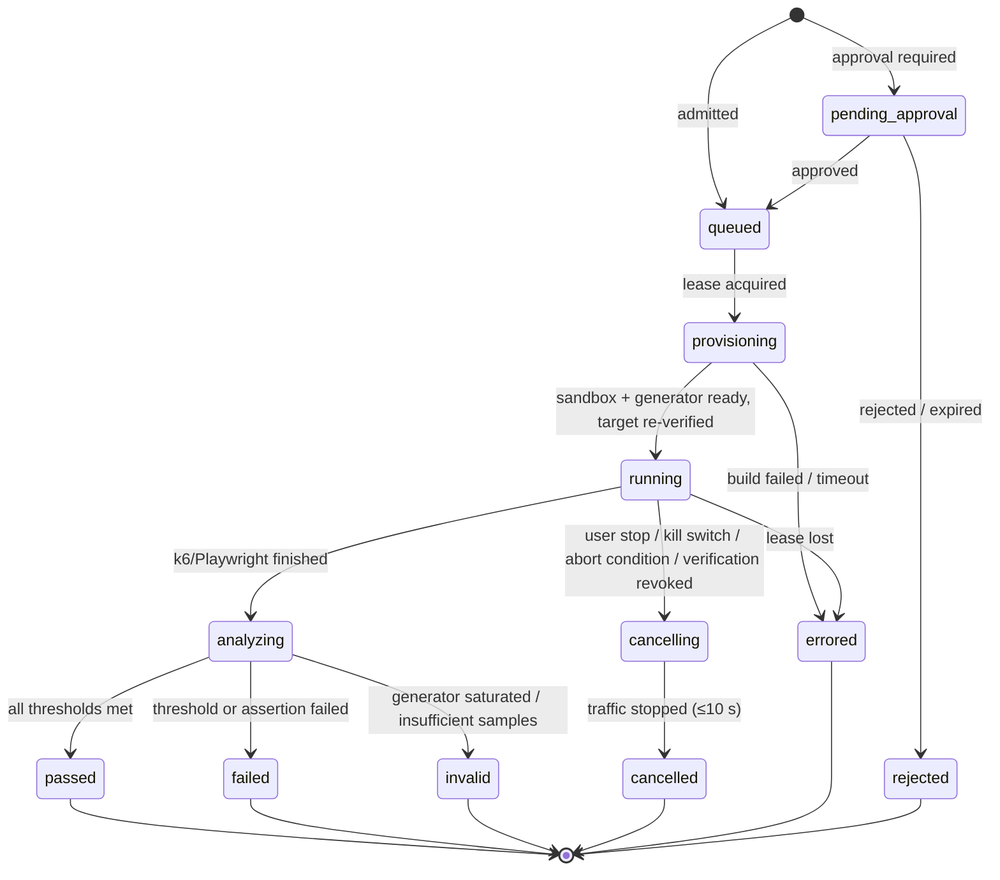

# Low-Level Design

> Gate 4 detail for [design.md](design.md). Data model: [data-model.md](data-model.md).
> API: [api-contract.md](api-contract.md). Agents: [agent-workflows.md](agent-workflows.md).

## Contents
1. Repository layout
2. Module boundaries
3. Cross-cutting backend rules
4. Run lifecycle (deterministic pipeline)
5. Execution plane: runner agent and sandboxes
6. Workflow IR
7. Test generation outputs
8. Detection: thresholds, baselines, findings
9. Verification pipeline
10. Background jobs
11. Frontend design
12. Testing strategy

---

## 1. Repository layout

```
apps/web/                          Next.js dashboard (App Router, TypeScript)
services/control-plane/            Python package `reliability`
  src/reliability/
    main_api.py                    FastAPI app factory (entrypoint: api)
    main_worker.py                 Celery app (entrypoints: worker-<queue>)
    platform/                      db session + RLS, auth, errors, outbox, storage, rate limit,
                                   audit writer, telemetry, settings, celery config
    modules/<module>/              api.py · service.py · repository.py · models.py ·
                                   schemas.py · jobs.py (only what the module needs)
    agents/
      common/                      state base, budgets, tool registry, untrusted-content wrapper
      discovery/  testgen/  diagnosis/  repair/   graph.py · nodes.py · prompts/ · tools.py
    llm/                           gateway, model routing, redaction, usage metering
  migrations/                      Alembic
  tests/{unit,integration,contract,agents}
services/runner-agent/             Python; leases jobs, drives Docker+gVisor, k6, Playwright
runners/images/                    sandbox-base, build (buildpacks), k6, playwright,
                                   coding-tools, zap-baseline, otel-autoinstrument
packages/api-client/               TS client generated from the control-plane OpenAPI
packages/workflow-ir/              JSON Schema for Workflow IR + TS/Python generated types
benchmarks/reference-apps/         seeded-defect apps (Next.js, Express, FastAPI)
benchmarks/harness/                benchmark runner + scoring (evaluation.md)
infra/terraform/                   control-plane, execution-plane, observability, shared
.github/workflows/                 ci.yml, evals.yml, images.yml, deploy.yml
```

## 2. Module boundaries

Dependencies point inward (`api → service → repository`). Services never import FastAPI types.
Modules call each other only through `service.py` public functions; never through another
module's tables. Vendors sit behind adapters (`ObjectStore`, `GitHubClient`, `LLMClient`,
`IdentityVerifier`, `KmsClient`, `EmailSender`, `TelemetryQuery`).

| Module | Responsibility | Owns | Public operations | Implements |
|---|---|---|---|---|
| identity | Map IdP subject → user; API-key auth | users, api_keys | `authenticate(request)`, `create_api_key`, `revoke_api_key` | FR-1, FR-30, FR-32 |
| tenancy | Orgs, memberships, roles, policy checks | organizations, memberships | `create_org`, `invite`, `require(role, resource)` | FR-1, FR-30 |
| projects | Project CRUD | projects | `create`, `get`, `archive` | UF-1 |
| integrations.github | App install, token minting, repo snapshot, branch push, PR | github_installations, repositories, pull_requests | `mint_token(job)`, `snapshot(repo, sha)`, `open_pr(repair)` | FR-2, FR-27 |
| targets | Register, verify, re-verify, classify | targets | `register`, `verify`, `assert_runnable(target, profile)` | FR-3…5 |
| secrets | Encrypted project secrets | project_secrets | `put`, `list_names`, `resolve_for_run(run)` | FR-11 |
| discovery | Start/track discovery graph; import OpenAPI | discovery_runs, openapi_specs | `start`, `status` | FR-6…9 |
| workflows | Candidate/approved workflows, Workflow IR validation | workflows | `approve`, `edit`, `coverage(project)` | FR-9, FR-13 |
| testsuites | Generate/version suites; validation status | test_suites, test_cases | `generate(project, workflows)`, `get_bundle(suite)` | FR-10, FR-12 |
| loadprofiles | Profile CRUD, k6 options compiler | load_profiles | `compile_k6_options(profile)` | FR-11, FR-16 |
| admission | One place for run gating | — (reads others) | `admit(run_request) -> Admitted | Rejected(code)` | FR-5, FR-14, FR-31 |
| runs | Run state machine, events, summaries | runs, run_events, run_metric_summaries | `create`, `transition`, `cancel`, `summary` | FR-14…19 |
| runners | Lease API, heartbeats, kill switch | runner_leases | `acquire`, `heartbeat`, `complete` | FR-18, NFR-4 |
| telemetry | Query LGTM per tenant; ingest tokens | — | `query_metrics`, `find_traces`, `search_logs` | FR-15, FR-23 |
| findings | Threshold/baseline evaluation, dedupe | findings, evidence | `evaluate_run(run)`, `attach_evidence` | FR-20 |
| diagnosis | Start diagnosis graph; rubric scoring | diagnoses, hypotheses, hypothesis_evidence | `diagnose(finding)`, `feedback` | FR-21, FR-22 |
| repairs | Start repair graph; attempts | repair_attempts | `propose_fix(hypothesis)`, `approve`, `reject` | FR-24, FR-27 |
| verification | Deterministic gate pipeline, comparisons | verification_gates, performance_comparisons | `verify(attempt)` | FR-25, FR-26 |
| approvals | Approval requests/decisions | approvals | `request`, `decide`, `require_approved` | FR-5, FR-27 |
| reports | Trends, coverage, HTML/JSON exports | — | `project_summary`, `export` | FR-28 |
| audit | Append-only hash-chained events | audit_events | `record(event)` | FR-29 |
| quotas | Plans, usage ledger, rate limits | plans, usage_ledger | `reserve`, `commit`, `release`, `rate_limit(key, class)` | FR-31 |
| llm | Gateway: routing, budgets, redaction, metering | llm_usage | `complete(purpose, messages, schema, budget)` | NFR-11 |

## 3. Cross-cutting backend rules

- **Validation:** Pydantic models with `extra="forbid"` at every boundary.
- **Error envelope:** `{"error": {"code": "TARGET_NOT_VERIFIED", "message": "...", "details": {}, "request_id": "..."}}`. Stable codes (catalog in api-contract.md). No stack traces.
- **Tenant context:** auth middleware resolves `org_id` and sets `SET LOCAL app.org_id` on the transaction; RLS does the rest. Background jobs receive `org_id` in the payload and set it the same way. A dedicated `platform_admin` role bypasses RLS only for operator tooling, and its use is audited.
- **Transactions + outbox:** state change and job enqueue are atomic: the service writes the row and an `outbox` row in one transaction; a relay publishes to Celery. Jobs are idempotent by `(job_type, subject_id, attempt)`.
- **Idempotency:** `Idempotency-Key` on POSTs that create runs, discoveries, suites, diagnoses, repairs, approvals; stored with a request hash for 24 h; replay returns the first response.
- **Timeouts:** every outbound call has a timeout (GitHub 10 s, LLM per-purpose 60–180 s, LGTM query 15 s, KMS 2 s). Retries only on idempotent operations: exponential backoff + jitter, max 5.
- **State machines:** `runs`, `repair_attempts`, `discovery_runs`, `diagnoses` change status only through guarded `transition(from, to)` updates (`UPDATE … WHERE status = :from`), so concurrent workers can't double-advance.
- **Logging:** JSON logs with `request_id`, `trace_id`, `org_id`, `project_id`, `run_id`; never secrets, tokens, test credentials, or source code.
- **IDs and time:** UUIDv7; UTC `timestamptz`.
- **Untrusted content:** any text from customer repos, target web pages, HTTP responses, logs, or LLM output is typed `Untrusted[str]` in agent code and must be wrapped by `render_untrusted()` (delimited, length-capped) before entering a prompt (see agent-workflows.md §7).

## 4. Run lifecycle (deterministic pipeline)



**Admission (`admission.admit`)**, in order, each failure a stable error code:
1. Caller role ≥ engineer on the project (`FORBIDDEN`).
2. Target `verified` and verification younger than 24 h; otherwise re-verify synchronously (≤ 5 s) (`TARGET_NOT_VERIFIED`).
3. Environment policy: `production` → only `smoke`, max 5 VUs, max 60 s, needs approval (`ENVIRONMENT_POLICY_VIOLATION`).
4. Plan caps: VUs, duration, profile type (`PLAN_LIMIT_EXCEEDED`).
5. Quota reservation: VU-minutes (`max_vus × duration_min`), sandbox-minutes estimate (`QUOTA_EXCEEDED`). Reservation converted to actual usage at completion; unused minutes released.
6. Concurrency: per-org concurrent runs, per-target concurrent runs = 1 for load profiles (`CONCURRENCY_LIMIT`).
7. Approval: first load profile against a target, any profile > 500 VUs, any production smoke → `pending_approval` (owner/admin decides).
8. Write `runs` row (`queued`) + outbox event + audit event in one transaction.

**Abort conditions** compiled into k6 thresholds with `abortOnFail` (FR-17):
`http_req_failed rate > abort_error_rate (default 0.5) for 30 s`, `checks rate < 0.5`,
target connection refusals > 95% for 15 s. Runner-side watchdog independently kills the
generator when control-plane heartbeat replies `cancel` or the run exceeds
`duration + ramp + 120 s`.

**Generator validity (FR-19):** runner samples generator CPU and k6 `dropped_iterations`;
CPU > 85% for > 20 s or any dropped iterations under an arrival-rate executor → results
`invalid`.

## 5. Execution plane: runner agent and sandboxes

**Host:** EC2 (16 vCPU / 64 GB class), Docker with `runsc` (gVisor) as default runtime,
IMDSv2 hop limit 1 with container access blocked, no instance-profile permissions beyond
pulling images and writing its own logs. Host is recycled after 50 runs or 24 h.

**Runner agent loop**
1. `POST /internal/runner/v1/leases:acquire` (long-poll 20 s, mTLS, host identity) advertising free capacity slots.
2. Receives a **lease**: job spec, run-scoped tokens (OTLP ingest, event post), presigned S3 GET/PUT URLs, egress allowlist, resource limits, secrets (encrypted to the host's public key, decrypted in memory, injected as env vars into the test container only).
3. Programs the egress proxy for the run network (`run-<id>` Docker network → proxy with SNI/Host allowlist of verified target hosts + package mirror for build jobs only).
4. Starts containers; heartbeats every 5 s with progress; executes `cancel` within one heartbeat.
5. Uploads artifacts via presigned PUT, posts completion, tears down network and containers, wipes volumes.

**Sandbox job types**

| Job | Containers | Network | Limits (default) |
|---|---|---|---|
| `functional` | Playwright runner | target hosts only | 2 vCPU, 4 GB, 20 min |
| `load` | k6 generator (+ telemetry sidecar) | target hosts only | 4 vCPU, 8 GB, duration + 10 min |
| `sandbox_build` | build container (buildpacks or Dockerfile) | package mirror only | 4 vCPU, 8 GB, 15 min |
| `sandbox_env` | app-under-test + Postgres/Redis (if detected) + OTel collector + exporters + stub server | internal only; generator joins the network | 4+2 vCPU, 12 GB, run duration |
| `coding_session` | coding-tools container with repo checkout | package mirror only | 2 vCPU, 4 GB, 30 min idle, 2 h max |
| `security_scan` | semgrep, osv-scanner, gitleaks, ZAP baseline (passive, sandbox target only) | package mirror / sandbox only | 2 vCPU, 4 GB, 15 min |

**App-under-test in sandbox (ADR-0011):** detect `docker-compose.yml` → use it (services
rewritten to `runsc`, ports internal); else `Dockerfile`; else Cloud Native Buildpacks.
Databases from compose or a detected ORM (Prisma, Drizzle, SQLAlchemy/Alembic, Django)
get an ephemeral Postgres with migrations applied and the project's seed script (or a
generated synthetic seed). External HTTP dependencies are routed to a stub server
(recorded/OpenAPI-driven mocks). OTel zero-code auto-instrumentation is injected for Node
and Python; `postgres_exporter` with `pg_stat_statements`, cAdvisor and Redis exporter
provide resource evidence.

## 6. Workflow IR

The single structured representation from which tests are generated (ADR-0013). JSON,
validated against `packages/workflow-ir/schema.json`; stored in `workflows.spec`.

```json
{
  "ir_version": "1.0",
  "key": "checkout.place_order",
  "title": "Place an order as a signed-in user",
  "kind": "browser",
  "criticality": "critical",
  "source": {"type": "browser_exploration", "evidence": ["route:/checkout", "file:app/checkout/page.tsx"]},
  "preconditions": [{"type": "login", "credential_ref": "secret:TEST_USER_1"}],
  "data": {"vars": {"email": {"faker": "internet.email"}, "qty": {"range": [1, 3]}}},
  "steps": [
    {"id": "s1", "action": "navigate", "url": "/products/{{product_id}}"},
    {"id": "s2", "action": "click", "locator": {"role": "button", "name": "Add to cart"}},
    {"id": "s3", "action": "navigate", "url": "/checkout"},
    {"id": "s4", "action": "click", "locator": {"role": "button", "name": "Place order"}},
    {"id": "s5", "action": "expect", "assertion": {"type": "text_visible", "value": "Order confirmed"}}
  ],
  "api_equivalent": [
    {"id": "a1", "request": {"method": "POST", "path": "/api/cart", "json": {"productId": "{{product_id}}", "qty": "{{qty}}"}},
     "extract": {"cart_id": "$.id"}, "expect": {"status": [200, 201]}},
    {"id": "a2", "request": {"method": "POST", "path": "/api/orders", "json": {"cartId": "{{cart_id}}"}},
     "expect": {"status": [201], "json_schema_ref": "#/components/schemas/Order"}}
  ],
  "invariants": [
    {"id": "inv1", "type": "concurrency_probe", "description": "Stock never goes negative",
     "parallel": 50, "step_ref": "a2",
     "check": {"request": {"method": "GET", "path": "/api/products/{{product_id}}"}, "jsonpath": "$.stock", "op": ">=", "value": 0}}
  ],
  "side_effects": ["creates_order"],
  "destructive": false,
  "load": {"weight": 0.2, "think_time_s": [1, 3]}
}
```

Rules: `browser` workflows produce Playwright tests; `api_equivalent` (or `kind: api`)
produces k6 scenarios — load never drives browsers (ADR-0012). `destructive: true` workflows
are excluded from load profiles unless explicitly opted in. Locators prefer roles/labels
(resilient), never generated CSS paths.

## 7. Test generation outputs

Per suite version, stored under `s3://…/org/<org>/project/<p>/suites/<v>/`:
- `playwright/` — `playwright.config.ts`, `tests/<workflow-key>.spec.ts`, `fixtures/auth.ts` (credentials from env).
- `k6/` — `lib/<workflow-key>.js` (one function per API workflow), `scenarios.js` (workload mix built from `load.weight`), `probes/<invariant>.js`.
- `manifest.json` — files, checksums, IR hashes, generator model/version, validation results.

Validation (FR-10, FR-12): `tsc --noEmit` + ESLint; `k6 inspect`; dry run against the target
(1 iteration, 1 VU); flake check (3 runs, all must agree). Failures feed back to the
test-generation graph (max 3 attempts), then `invalid`.

Users can download the bundle or have it committed via PR to `tests/reliability/` (same
approval path as repairs).

## 8. Detection: thresholds, baselines, findings

Deterministic evaluation after each run (`findings.evaluate_run`):

| Finding type | Rule (defaults; configurable) | Fingerprint |
|---|---|---|
| `functional_failure` | Playwright test failed in 2 of 2 attempts (retry once) | workflow key + step id + normalized error |
| `flaky_test` | passed on retry | workflow key + step id |
| `slo_breach` | per-scenario p95 > threshold or error rate > threshold over steady-state window (ramp excluded) | scenario + metric |
| `regression` | p95 or error rate worse than the project's rolling baseline (median of last 5 valid baseline runs) by > max(10%, noise floor) | endpoint + metric |
| `saturation` | sandbox evidence: DB connections ≥ 90% of max, CPU ≥ 90%, memory ≥ 90%, event-loop lag > 100 ms, pool wait time > 0 for > 30 s | resource + component |
| `error_spike` | 5xx rate step-change detected (CUSUM) during the run | endpoint + status class |
| `invariant_violation` | concurrency probe check failed | workflow key + invariant id |

Each finding is created with deterministic evidence attached (failing assertion, metric
window query, top slow trace IDs, matching log excerpts). Knee detection for stress runs:
the VU level where p95 crosses threshold or throughput stops increasing is recorded as
the project's measured capacity.

## 9. Verification pipeline

Run by the `verification` module (deterministic Celery chain), never by the repair agent
(ADR-0007, ADR-0016). Inputs: base commit `B`, patch `P`, regression test `T`, finding.

| # | Gate | Pass condition | Applies to |
|---|---|---|---|
| 1 | `build` | `B+P` builds in sandbox | all |
| 2 | `existing_tests` | repo's own test command passes on `B+P` (or same failures as on `B`, recorded) | all, if the repo has tests |
| 3 | `fail_to_pass` | `T` fails on `B` and passes on `B+P` (3/3 runs each) | all |
| 4 | `functional_suite` | approved Playwright suite passes against `B+P` sandbox | all |
| 5 | `security` | no new high/critical Semgrep, osv-scanner, gitleaks findings vs `B`; ZAP passive baseline no new high alerts | all |
| 6 | `load_comparison` | interleaved A/B runs (≥ 3 each) in identical sandbox spec; p95 improvement CI excludes 0 and ≥ noise floor; error rate not worse | performance findings |
| 7 | `invariant_probe` | the violated invariant holds on `B+P` in 5/5 probe runs | invariant findings |
| 8 | `diff_policy` | diff ≤ limits; touches only allowed paths; no new dependencies unless approved; no CI/infra/secret files changed | all |

`verified` = all applicable gates `passed`. Results and the statistics are stored in
`verification_gates` and `performance_comparisons` and shown verbatim in the PR body.

## 10. Background jobs

| Job (queue) | Trigger | Payload | Idempotency | Retry | Timeout | User sees |
|---|---|---|---|---|---|---|
| `outbox.relay` (default) | every 1 s + NOTIFY | — | outbox row `dispatched_at` | infinite | 30 s | — |
| `targets.verify` (default) | user click; daily re-verify | target_id | status check | 3, backoff | 10 s | verification result |
| `targets.reverify_sweep` (scheduled) | hourly | — | per-target | — | 5 min | expired targets marked |
| `discovery.run` (agents) | user | discovery_run_id | LangGraph thread checkpoint | resume from checkpoint ×3 | 30 min | progress steps |
| `testsuites.generate` (agents) | approval of workflows | suite_id | checkpoint | ×3 | 30 min | per-case status |
| `runs.dispatch` (default) | outbox `run.queued` | run_id | lease uniqueness | — | — | queued → provisioning |
| `runs.reap` (scheduled) | every 30 s | — | guarded transition | — | — | lost leases → `errored` |
| `runs.analyze` (default) | lease complete | run_id | guarded transition | 3 | 10 min | analyzing → result |
| `findings.evaluate` (default) | run analyzed | run_id | unique fingerprint upsert | 3 | 5 min | findings |
| `diagnosis.run` (agents) | user / auto for critical | diagnosis_id | checkpoint | resume ×3 | 20 min | hypotheses |
| `repair.run` (agents) | user | repair_attempt_id | checkpoint | resume ×2 | 2 h | coding / verifying |
| `verification.run` (default) | candidate patch | repair_attempt_id | per-gate rows | per gate ×1 | 2 h | gate checklist |
| `github.open_pr` (default) | approval | repair_attempt_id | `pull_requests` unique | 5, backoff | 60 s | PR link |
| `reports.export` (default) | user | report_id | key by params hash | 3 | 5 min | download link |
| `retention.sweep` (scheduled) | daily | — | delete-by-age batches | — | 1 h | — |
| `usage.rollup` (scheduled) | hourly | — | upsert per org/hour | — | 10 min | usage page |
| `audit.anchor` (scheduled) | daily | — | per day | 3 | 5 min | — |

Dead letters: after max retries, the job is recorded in `outbox` with `failed_at` and an
alert fires; the subject entity transitions to `errored` with a user-visible reason.

## 11. Frontend design

- **Rendering:** Next.js App Router; authenticated app is client-heavy (React Server Components for shells, client components for live data). Marketing pages static.
- **Server state:** TanStack Query over the generated typed client; no global store except current user/org.
- **Auth:** IdP SDK session in the browser; access token (short-lived JWT) attached to API calls; on 401 → silent refresh → login.
- **Live data:** `EventSource` on `/v1/runs/{id}/events`; reconnect with `Last-Event-ID`; fall back to polling every 5 s.
- **Charts:** ECharts; data from `/v1/runs/{id}/metrics` and `/v1/projects/{id}/trends`.
- **Every data view** has loading, empty, error and success states. Long operations (discovery, generation, diagnosis, repair) show step-level progress from their event streams.
- **Trust UI:** every hypothesis shows confidence badge + "why" (rubric factors) + evidence list with deep links; every "verified" badge links to its gate results; coverage always shown as "N of M discovered workflows tested".
- **Dangerous actions** (start load run, approve PR, production smoke) use a confirmation dialog that restates target host, environment, VUs and duration.
- **Accessibility:** WCAG 2.1 AA — semantic HTML, keyboard reachable, chart data also available as tables.

| Route | Purpose | Reads | Actions | Min role |
|---|---|---|---|---|
| `/onboarding` | UF-1 wizard | org, installations | create project, install app, add target, verify | owner/admin |
| `/projects/[id]` | Overview: health, last runs, open findings, coverage | summary | — | viewer |
| `/projects/[id]/targets` | Targets and verification | targets | add, verify, revoke | admin |
| `/projects/[id]/discovery` | Discovery runs and progress | discovery_runs | start | engineer |
| `/projects/[id]/workflows` | Candidates and approved workflows, IR editor | workflows | approve, edit, reject, add | engineer |
| `/projects/[id]/suites` | Suite versions, case validation | suites, cases | generate, download, export PR | engineer |
| `/projects/[id]/profiles` | Load profiles | profiles | CRUD | engineer |
| `/projects/[id]/runs` | Run history | runs | start run | viewer / engineer |
| `/projects/[id]/runs/[runId]` | Live + results | run, events, metrics, artifacts | stop, compare | viewer / engineer |
| `/projects/[id]/findings` | Findings list | findings | triage | viewer |
| `/projects/[id]/findings/[fid]` | Evidence + hypotheses | finding, evidence, diagnoses | diagnose, feedback, propose fix | engineer |
| `/projects/[id]/repairs/[rid]` | Diff, gates, comparison | repair, gates, comparison | approve → PR, reject | engineer |
| `/projects/[id]/reports` | Trends, coverage, exports | reports | export | viewer |
| `/settings/*` | Members, API keys, usage, audit, integrations | — | manage | admin/owner |
| `/approvals` | Pending approvals | approvals | decide | admin/owner |

## 12. Testing strategy

| Layer | What | How |
|---|---|---|
| Unit | admission rules, rubric scoring, comparison statistics, threshold evaluation, IR validation, k6 options compiler, diff policy | pytest, property tests (Hypothesis) for statistics and admission |
| Integration | repositories with RLS **enabled** against real Postgres; outbox relay; Celery chains; MinIO for S3; fake GitHub (recorded); fake LLM (deterministic fixtures) | pytest + testcontainers |
| Contract | every endpoint: success + documented errors; cross-tenant access returns 404 for every resource type; role matrix | schemathesis against OpenAPI + explicit tenancy suite |
| Runner | lease protocol, kill within 10 s, egress denial to non-allowlisted hosts, metadata endpoint unreachable | integration on a real gVisor host in CI (nightly) |
| Agent evals | discovery recall, test validity, diagnosis precision, repair success — golden datasets | `benchmarks/harness`, run on prompt/model changes and nightly (evaluation.md) |
| End-to-end | UF-1→UF-6 against the reference app | Playwright against staging |
| Platform load | NFR-1 generator capacity, NFR-4 job start, API p95 | k6 against staging control plane |

Every FR maps to at least one test; the mapping is kept in `plan.md` per phase.
