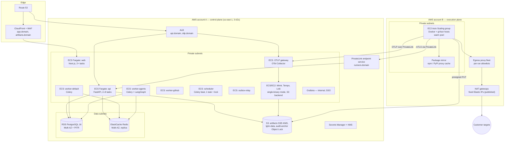

# Operations: Deployment, Reliability, Observability, Cost

> Gate 6 detail for [design.md](design.md). Cloud: AWS (Assumed, [ADR-0020](decisions/0020-host-on-aws-managed-services.md)).

## Contents
1. Deployment architecture
2. Environments and release process
3. Failure-mode table
4. Scale tier and capacity math
5. Meeting the job-start SLO (NFR-4)
6. Observability and SLOs
7. Backups and disaster recovery
8. Cost model
9. Runbooks

---

## 1. Deployment architecture

| Workload | Platform | Sizing (start) | Scaling |
|---|---|---|---|
| web | ECS Fargate | 2 × 0.5 vCPU / 1 GB | CPU target 60% |
| api | ECS Fargate | 2 × 1 vCPU / 2 GB | CPU 60%, min 2 (one per AZ) |
| worker-default | ECS Fargate | 2 × 1 vCPU / 2 GB | queue depth |
| worker-agents | ECS Fargate | 2 × 2 vCPU / 4 GB | queue depth (I/O-bound, high concurrency per task) |
| worker-github, outbox-relay, scheduler | ECS Fargate | 1–2 small tasks | fixed |
| OTLP gateway | ECS Fargate | 2 × 1 vCPU / 2 GB | CPU, spans/s |
| Mimir/Tempo/Loki | EC2 (or Fargate) single-binary each, S3 storage | 2 vCPU / 8 GB each | vertical first; microservices mode at > ~1M active series |
| RDS PostgreSQL | db.r7g.large Multi-AZ | 2 vCPU / 16 GB, gp3 | vertical; read replica for reports when needed |
| ElastiCache Redis | cache.r7g.large, 1 replica | | vertical |
| Execution hosts | EC2 c7i.4xlarge (16 vCPU / 32 GB) or m7i.4xlarge for sandbox_env | warm pool 2–3 | queue depth + reserved slots |
| Egress proxy | EC2 2 × c7gn.large behind NLB | | network throughput |

**Why ECS/Fargate and EC2 rather than Kubernetes** ([ADR-0009](decisions/0009-isolate-untrusted-execution-in-gvisor-sandboxed-docker-on-dedicated-hosts.md)):
the control plane is a handful of stateless services that Fargate runs without cluster
operations; the execution plane needs a custom runtime (gVisor) and host-level network
control, which plain EC2 hosts with a runner agent provide simply. Kubernetes becomes
justified when **any** trigger holds: > ~20 execution hosts sustained, distributed k6 via
k6-operator (runs > 1 generator), multi-region generators, or a platform team to own it.

## 2. Environments and release process

| Env | Purpose | Data |
|---|---|---|
| local | docker-compose: Postgres, Redis, MinIO, LGTM, fake GitHub, fake LLM; runner with runc (gVisor optional) | synthetic |
| ci | ephemeral containers for integration tests; nightly real gVisor host | synthetic |
| staging | full topology, smaller sizes; reference apps as targets; agent evals | synthetic + benchmark |
| production | as above | customer |

**CI (GitHub Actions, every PR):** ruff + mypy (strict on `admission`, `runs`, `verification`),
pytest unit + integration (testcontainers), schemathesis contract tests, ESLint + tsc +
vitest for web, Playwright component/E2E smoke, OpenAPI diff check (breaking change =
fail), Workflow IR schema compatibility, osv-scanner + Trivy + gitleaks, SBOM, agent evals
if `agents/**` or `llm/**` changed.

**CD:** images built once and signed (cosign); deploy to staging automatically on `main`;
smoke + E2E on staging; manual promotion to production. ECS rolling deploy with
minimum-healthy 100% and health-check grace; automatic rollback on failed health checks or
error-rate alarm within 10 min. Alembic migrations run as a one-off ECS task **before**
the new version, written expand → migrate → contract so old and new code both work.
Execution-plane AMIs baked weekly with Packer (OS + Docker + gVisor patches, pre-pulled
runner images by digest) and rolled by ASG instance refresh, draining hosts only after
active leases finish.

**Feature flags:** per-org and global flags for graphs, profile types, browser exploration,
repair, and the kill switch.

## 3. Failure-mode table

| Failure | Detection | User-visible behavior | System behavior | Recovery |
|---|---|---|---|---|
| RDS primary failure | RDS event; API readiness fails | ≤ ~2 min of 503 + Retry-After | Multi-AZ failover; connections re-established; in-flight requests fail fast | automatic |
| Data corruption / bad migration | errors, integrity checks | maintenance banner | stop writers | PITR restore to new instance, cut over (RTO ≤ 1 h) |
| Redis down | health check | live charts pause (UI falls back to polling Postgres events); job start delayed | outbox holds work; rate limiter: fail closed for run/agent creation, open for reads | Multi-AZ failover; relay drains outbox |
| Celery task lost (worker killed, visibility timeout) | Postgres state machine shows subject stuck past deadline | status remains "queued/running" then resumes | `acks_late`; `runs.reap`/subject reapers re-enqueue idempotent steps; LangGraph resumes from checkpoint | automatic |
| Outbox relay stopped | outbox lag metric | new jobs don't start | alarm at lag > 30 s | ECS restarts; relay idempotent |
| Runner host dies mid-run | missed heartbeats (15 s) | run `errored: runner lost`, quota refunded | lease expired; egress rules for run removed; host terminated | user re-runs; load runs never auto-retried (avoid surprise traffic) |
| Execution capacity exhausted | queue age, no free slots | "Waiting for capacity (position N)" | ASG scale-out; warm pool consumed | scale-out completes 2–4 min |
| Sandbox build fails | build exit code | run `errored: build_failed` with log | — | user fixes / uses preview URL fallback |
| Load generator saturated | CPU > 85%, dropped iterations | results `invalid` with explanation | performance verdicts suppressed | re-run on larger generator class |
| Target unreachable / 5xx flood | abort thresholds | run stopped, `slo_breach`/`error_spike` finding | `abortOnFail`; runner kill | — |
| Target verification revoked mid-run | re-verify sweep / user revoke | run `cancelled: target_revoked` | heartbeat returns `cancel` | — |
| Egress proxy failure | health checks, connection errors | run errored, not attributed to target | runs fail closed (no direct egress path) | proxy fleet behind NLB, ≥ 2 instances |
| LLM provider outage / 429 | gateway error rate | diagnosis/repair "delayed — retrying" | retries with backoff; fallback to alternate model tier; checkpoint resume | automatic; alert after 15 min |
| LLM returns invalid structured output | schema validation | — | re-ask once with validation errors; then node fails → partial result | — |
| Agent budget exhausted | gateway | `budget_exhausted` with partial results | quota released for unused part | user may extend once |
| GitHub API error / rate limit | HTTP status | "PR pending, retrying" | outbox retry with backoff (5×) | manual retry button |
| GitHub App uninstalled | webhook | project shows "Repository disconnected" | discovery/repair disabled | reinstall |
| LGTM down | gateway export errors, query errors | live charts from Redis still work; diagnosis evidence limited | OTLP gateway buffers (persistent queue, 1 h); runs continue | backfill from buffer |
| Bad deploy | error-rate / latency SLO burn | brief errors | auto rollback | post-incident review |
| Kill switch triggered | operator action | runs show `cancelled: platform_kill_switch` | all leases told `cancel`; admission rejects | flag off |

## 4. Scale tier and capacity math

Assumptions (NFR-10, Assumed): 300 active orgs, 1,000 projects; per active org per month:
20 load runs, 100 functional runs, 10 diagnoses, 4 repair attempts.

**Load runs.** 300 × 20 = 6,000/month ≈ 200/day. Concentrated in ~8 working hours (two
regions of customers) → ~25/hour; average occupancy 25 min (provision 3 + ramp 2 + steady 10
+ analysis/teardown 5 + some longer soaks) → ~10 concurrent average, **peak ×2.5 ≈ 25
concurrent** (NFR-10).

**Compute per 1,000-VU run.** k6 protocol-level VU memory ~1–5 MB for simple scripts →
≤ 5 GB; with 1–3 s think time 1,000 VUs produce ~300–700 req/s, comfortably within a 4-vCPU
generator (k6 typically sustains well over 1,000 simple HTTP req/s per core; NFR-1 benchmark
confirms this for our generated scripts before launch). Sandbox-env runs add
the app-under-test + DB: ~6 vCPU. Per run ≈ 4 + 6 = **10 vCPU** for ~25 min ≈ **2.5–4
vCPU-hours** (NFR-11 target 2.5 when targeting customer URLs with generator only: 4 vCPU × 0.4
h ≈ 1.6 vCPU-h; sandbox-env runs ≈ 4 vCPU-h).

**Peak execution capacity.** 25 load runs × 10 vCPU = 250 vCPU + functional runs (100/hour ×
2 vCPU × 5 min ≈ 17 vCPU) + repair sessions (10 × 2 vCPU + verification builds ≈ 40 vCPU)
≈ **310 vCPU ≈ 20 hosts of 16 vCPU at peak**; off-peak 2–3 hosts warm. This is near the
Kubernetes trigger (≈ 20 hosts), which is recorded as Deferred and re-evaluated with real
usage.

**Generator bandwidth.** 700 req/s × (~2 KB request + ~20 KB response) ≈ 15 MB/s ≈ 125
Mbit/s per run; 25 concurrent ≈ 3 Gbit/s peak through egress proxies/NAT — size proxies
for this and use bodies-discarded mode to cut generator memory.

**Control-plane API.** Dashboard: ~200 concurrent users at peak × 1 req/5 s ≈ 40 req/s +
SSE connections (≤ 500 open) + runner heartbeats (≤ 100 leases / 5 s = 20 req/s) + CI calls
(≤ 10 req/s) → **< 100 req/s**: two 1-vCPU API tasks with headroom; SSE handled by async
FastAPI (one event-loop task per connection, Redis pub/sub fan-out).

**Postgres.** Rows/day: run_events ~200 load runs × 300 progress events + functional
events ≈ 100k/day; audit ≈ 50k/day; others small → < 5 GB/year hot data before retention.
Connections: API (4 tasks × 10) + workers (6 × 10) + relay ≈ 110 → under RDS limits; add
RDS Proxy if Fargate task count grows.

**Telemetry.** Per sandbox-env load run: k6 metrics (≈ 50 series per endpoint × 20
endpoints = 1k series) + app/DB/container metrics (≈ 2k series) → ~3k active series per run,
75k at peak — small for Mimir single-binary. Traces: 700 req/s × 10 spans = 7k spans/s per
run before sampling; tail sampling (errors + slowest 5% + 5% random) keeps ~10% → 700
spans/s/run, ≤ 17k spans/s at peak → Tempo single-binary OK with S3 backend.

**LLM.** 300 orgs × (10 diagnoses × 300k + 4 repairs × 1.5M + discovery/test-gen ≈ 1M) ≈
300 × 10M = **3B tokens/month upper bound**, much of it cacheable input (prompt caching on
system prompts and evidence packs). This is the dominant variable cost; budgets are the
control (cost model §8).

**Tier chosen:** Tier 2 control plane (stateless, Multi-AZ, autoscaled), elastic execution
pool. **Next-tier triggers (Deferred):** > 20 execution hosts sustained or > 1 generator per
run → Kubernetes + k6-operator; API p95 > 300 ms at peak → more tasks + read replica;
> 1M active series → Mimir microservices mode; customers outside NA/EU latency → regional
generators.

## 5. Meeting the job-start SLO (NFR-4)

"Job start" = lease acquired and the first container started. Target: 95% within 30 s.
- EC2 cold start + boot is 60–120 s → cannot be on the critical path. **Warm pool**: keep
  ≥ 20% free slots (min 2 hosts) with images pre-pulled; ASG warm pool (stopped instances)
  for 30–60 s scale-out.
- Runners long-poll leases (≤ 20 s) and get work in < 1 s when a job is queued (API wakes
  waiting long-polls via Redis).
- Container start under gVisor ≈ 1–3 s; sandbox builds are excluded from "start" but have
  their own target (p95 build < 5 min with layer caching per project).
- Control-plane jobs: dedicated Celery queues (`default`, `agents`, `github`) so a backlog of
  long agent tasks never blocks run dispatch; prefetch multiplier 1.
- Metric: `job_start_seconds` histogram by job type; SLO alert on burn rate.

## 6. Observability and SLOs

**Platform telemetry** (our services; separate from customer evidence telemetry):
OTel SDK (FastAPI, Celery, SQLAlchemy, httpx instrumentation) → OTel Collector →
Mimir/Tempo/Loki tenant `platform` → Grafana (internal) + Sentry for exceptions.

| Signal | Metrics |
|---|---|
| API (RED) | request rate, error rate, duration by route; SSE connections |
| Queues | depth and **oldest message age** per queue; outbox lag; task duration/failures |
| Runs | job_start_seconds, runs by status, runner heartbeat lag, lease expirations, kill latency |
| Execution plane (USE) | host CPU/mem/disk, free slots, warm pool size, gVisor container failures, egress denials |
| Agents | graph duration, node failures, tokens by purpose/model, budget exhaustion rate, schema-invalid rate, LLM latency and 429s |
| Business | signups, verified targets, runs/day, findings, diagnoses with ≥1 hypothesis, verified repairs, PRs opened/merged |
| Safety | admissions rejected by code, verification failures, anomaly-queue size, cross-tenant RLS errors (must be 0) |

**SLOs and alerts**

| SLO | Objective | Alert |
|---|---|---|
| Control-plane availability (NFR-3) | 99.9% of API requests non-5xx and synthetic checks pass, monthly | multi-window burn rate (2%/1 h, 5%/6 h) → page |
| API latency (NFR-5) | p95 of read requests < 300 ms, measured monthly | burn rate → ticket |
| Job start (NFR-4) | 95% < 30 s | burn rate → page during business hours |
| Kill latency (NFR-7) | 100% < 10 s | any breach → page + incident |
| Live metrics delay (FR-15) | p95 < 5 s | ticket |
| Backups | daily success + weekly restore test | failure → page |

Synthetic monitoring: a canary org runs a smoke + small load run against the reference app
every 15 min (exercises the full path: admission → lease → k6 → findings).

## 7. Backups and disaster recovery

| Data | Mechanism | RPO | RTO |
|---|---|---|---|
| Postgres | RDS automated backups, PITR (14 days), daily snapshot copied to second region | ≤ 5 min | ≤ 1 h (restore + cutover) |
| Artifacts (S3) | versioning (7-day noncurrent), lifecycle expiry; cross-region replication **not** enabled (evidence is reproducible) | n/a | n/a |
| Audit anchors | S3 Object Lock (compliance mode, 1 year), replicated cross-region | 24 h | — |
| LGTM telemetry | not backed up (30-day evidence; summaries in Postgres) | — | — |
| Redis | no backup (no authoritative data) | — | minutes |
| Infrastructure | Terraform state in S3 + DynamoDB lock; full rebuild documented | — | ≤ 4 h (region loss, Deferred multi-region) |
| Secrets | Secrets Manager with replication | — | — |

**Restore drills:** weekly automated restore of the latest snapshot into staging with
integrity checks (row counts, audit chain verification); quarterly game day (RDS failover,
Redis loss, runner fleet loss, LLM outage).

## 8. Cost model

Per-unit cost drivers and levers (dollar figures to be computed from current price sheets
during Phase 0; ratios are the design inputs):

| Driver | Unit | Lever |
|---|---|---|
| Execution compute | vCPU-hours per run (1.6 generator-only; ~4 with sandbox env) | warm-pool sizing by hour of day; Spot for functional/coding/build jobs (interruptible, retried); On-Demand/Savings Plans for load generators (interruption would invalidate results) |
| LLM tokens | tokens per diagnosis / repair attempt / workflow | tier routing, prompt caching, deterministic evidence pre-summarization, budgets, skip LLM for findings the rules already explain |
| Telemetry storage | active series, spans/s, GB logs | tail sampling, 30-day retention, S3 backend, drop high-cardinality labels (no user ids, no raw URLs — path templates only) |
| Data services | RDS + Redis instance hours | right-size; reserved instances after 3 months of data |
| Network | NAT/egress GB | generators discard response bodies; artifacts compressed (zstd) |

**Plan design guidance:** a free tier limited to smoke + ≤ 50 VUs and no repair keeps abuse
and cost bounded; paid plans price VU-minutes and agent actions explicitly so heavy users
pay for what they consume.

## 9. Runbooks (to write in Phase 10)

Kill switch · abuse report against an egress IP · GitHub App key rotation · RDS PITR restore ·
runner fleet replacement (gVisor CVE) · LLM provider degradation · LGTM backfill ·
cross-tenant access alarm · customer data deletion request.
